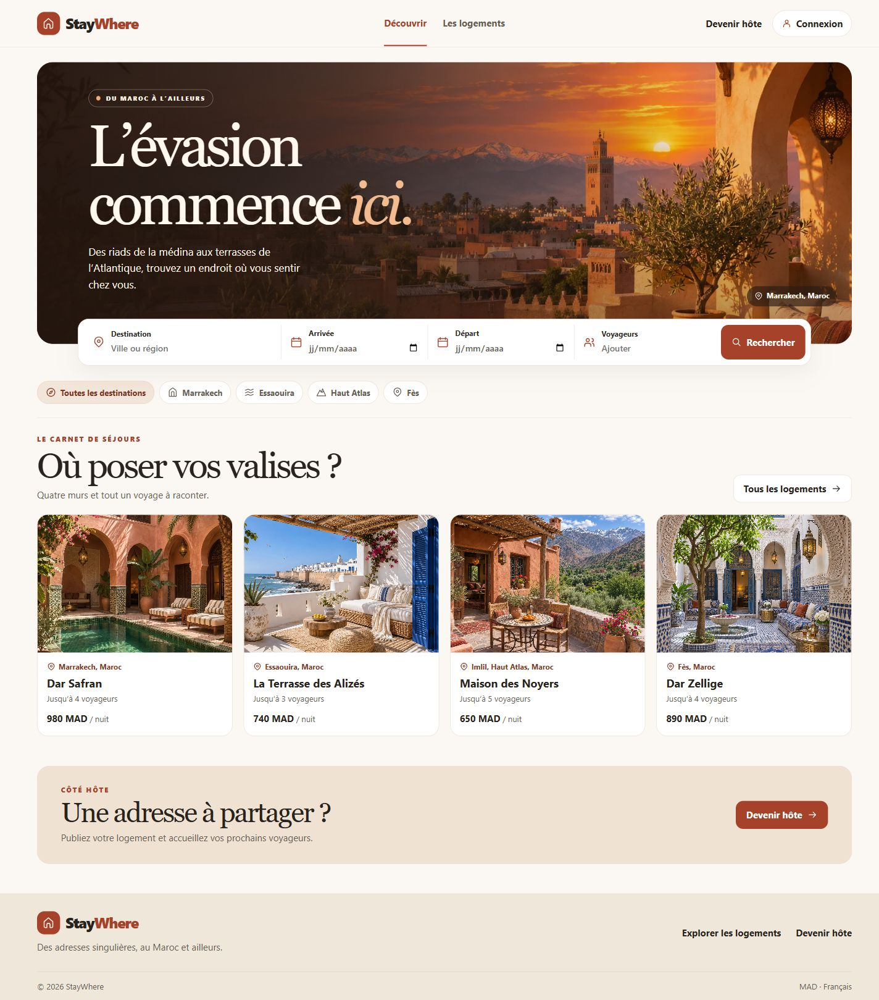

# StayWhere

Plateforme de location saisonnière en PHP et MariaDB. StayWhere est la refonte d’un projet étudiant avec une interface en français et un catalogue de démonstration inspiré du Maroc.

## Parcours

- **Voyageur** — recherche par destination, dates, capacité et budget, tri des prix, fiches avec galerie, favoris et suivi des demandes.
- **Hôte** — publication de logements, gestion des photos et traitement des demandes. Une confirmation bloque les nuits concernées. Le jour du départ peut servir d’arrivée au séjour suivant.
- **Administration** — gestion des comptes et du catalogue.

Les paiements et la messagerie intégrée restent hors du périmètre de cette version.

## Démarrer avec XAMPP

1. Installer PHP 8.2 ou ultérieur avec `pdo_mysql` et démarrer MySQL depuis XAMPP.
2. Créer une base vide nommée `staywhere` avec l’interclassement `utf8mb4_unicode_ci`, puis y importer `database/schema.sql` dans phpMyAdmin.
3. Copier `config.example.php` vers `config.local.php` si votre connexion diffère de la configuration XAMPP par défaut. Les variables d’environnement `DB_HOST`, `DB_PORT`, `DB_NAME`, `DB_USER`, `DB_PASSWORD` et `STAY_CURRENCY` ont priorité.
4. Depuis le dossier du projet, charger éventuellement les quatre logements fictifs avec `php bin/demo.php`. Le script crée un hôte et un voyageur de démonstration, puis affiche leur mot de passe généré dans le terminal.
5. Exécuter `php -S 127.0.0.1:8080 bin/router.php` et ouvrir [StayWhere en local](http://127.0.0.1:8080/). Si le projet est placé dans `htdocs`, il peut aussi être ouvert via Apache.

Pour créer un administrateur depuis le terminal, exécuter `php create-admin.php adresse@example.com`. L’utilisateur du serveur doit pouvoir écrire dans `uploads/stay_images` et `uploads/profile_pics`.

### Reprendre une ancienne installation

Travailler sur une copie sauvegardée de l’ancienne base. Exécuter une fois `database/upgrade-legacy.sql` pour ajouter le nombre de voyageurs et arrêter la purge automatique des anciennes réservations. Indiquer la connexion dans `config.local.php` et recopier les anciens fichiers téléversés. Renseigner la devise historique avec `currency` pour conserver le sens des anciens prix. Les annonces déjà masquées restent masquées et leur hôte peut les republier depuis son espace. Le script de démo s’utilise uniquement avec une base neuve.

## Démonstration

Les logements et les comptes de démonstration sont fictifs. Les visuels WebP dans `assets/` ont été générés pour le projet avec imagegen. Les sujets sont un toit de Marrakech au coucher du soleil, la cour d’un riad, une terrasse d’Essaouira, une maison du Haut Atlas et un patio de Fès. La base historique et les fichiers téléversés sont exclus du dépôt.

GitHub héberge le code source. L’application s’exécute sur un serveur PHP connecté à MariaDB ou MySQL.
